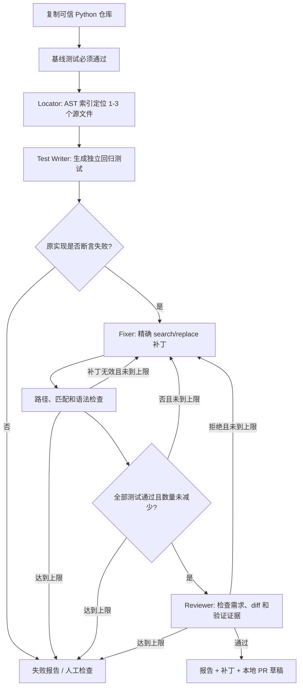

# BugFix Agent

[](https://github.com/Hudson-21/bugfix-agent/actions/workflows/ci.yml)

**面向可信小型 Python 仓库的多角色 Bug 修复助手：先复现，再修复，用测试和审查决定是否接受补丁。**

默认接入 DeepSeek 官方 API，也支持兼容 Chat Completions 的服务。定位、测试、修复和审查使用同一模型的独立角色，由显式状态机编排；最多两轮修复，输出 HTML 报告、测试日志、代码差异与本地 PR 草稿。

## 快速开始：无需密钥

要求 **Python 3.11+**；运行项目自身的完整测试还需 Git。下载或克隆仓库后，在项目根目录运行，建议使用独立虚拟环境：

```sh
git clone https://github.com/Hudson-21/bugfix-agent.git
cd bugfix-agent
python -m pip install -e .
python -m bugfix_agent demo --case coupon --open
```

命令结束后，浏览器打开本次生成的报告。默认 `demo` 使用手写预设响应，但补丁应用与 pytest 执行是真实的；**预设演示不证明模型修复能力**。如果没有图形界面，省略 `--open`，根据终端输出找到报告文件。

## 真实运行证据

已通过兼容接口完成 coupon、pagination 和 average 三个案例的 live 运行。coupon 首次结果：

| 项目 | 观察结果 |
|---|---|
| 问题 | 订单 10000 分、优惠 15000 分，原实现返回 -5000 分 |
| 复现 | 模型新增 1 个测试，在原代码上断言失败 |
| 修复 | 第一轮增加金额零下界 |
| 回归 | 原有 5 项 + 新增 1 项，共 6 项通过 |
| API 请求 / 有效回复 | 4 / 4 |
| 总耗时 | 13.57 秒 |
| 输入 / 输出 Tokens | 2677 / 361 |

查看 [运行记录与限制](docs/真实模型运行记录.md)、[完整 JSON 证据](docs/evidence/coupon-live/report.json) 和 [实际补丁](docs/evidence/coupon-live/patch.diff)。克隆后可用浏览器打开 `docs/evidence/coupon-live/report.html`；GitHub 文件页不会直接执行 HTML。

分页案例也在第一轮修复成功：原有 3 项测试通过，模型新增 5 项测试，其中 2 项在原代码上断言失败，修复后共 8 项通过；4 次 API 请求，耗时 39.818 秒。查看 [分页完整证据](docs/evidence/pagination-live/report.json) 和 [补丁](docs/evidence/pagination-live/patch.diff)。

平均值案例在第一轮将 `//` 改为 `/`：基线 3 项通过，新增 3 项测试在原代码上 2 项断言失败、1 项通过，修复后共 6 项通过；4 次 API 请求，耗时 15.11 秒。查看 [平均值完整证据](docs/evidence/average-live/report.json) 和 [补丁](docs/evidence/average-live/patch.diff)。原始模型回复中对负数整除结果的一处误述已在[运行记录](docs/真实模型运行记录.md#平均值案例)中注明，没有改写历史回复。

历史报告已移除本机绝对路径，其余运行数据保留。**这是三个简单案例的联调，不能解释为整体成功率。** 默认配置使用官方接口；官方接口尚未实测，实际历史测试来源在运行记录中说明。

演示时可按[两分钟演示指南](docs/演示指南.md)展示问题、复现失败、修复后通过与补丁；指南区分历史 live 证据和现场预设演示，视频尚未录制。

## 接入 DeepSeek 官方 API

在 [DeepSeek 开放平台](https://platform.deepseek.com/) 获取 API Key。程序默认 Base URL 为 `https://api.deepseek.com`、模型为 `deepseek-chat`。模型名称应与官方账户当前可用的 model ID 一致。

在项目目录运行以下命令，按提示隐藏输入密钥：

```sh
python -m bugfix_agent demo --case coupon --live --ask-key --open
```

密钥输入不显示字符或星号。Windows 终端可右键或 Ctrl+Shift+V 粘贴，再回车。`--ask-key` 不把输入保存到文件或环境变量。也支持预先设置 `DEEPSEEK_API_KEY` 后省略此参数；`.env.example` 只是参考，程序不会自动读取 `.env`。

如果之前配置过其他平台，先明确切回官方配置。

**Windows CMD：**

```cmd
set "DEEPSEEK_BASE_URL=https://api.deepseek.com"
set "DEEPSEEK_MODEL=deepseek-chat"
```

**PowerShell：**

```powershell
$env:DEEPSEEK_BASE_URL = 'https://api.deepseek.com'
$env:DEEPSEEK_MODEL = 'deepseek-chat'
```

**macOS / Linux：**

```sh
export DEEPSEEK_BASE_URL=https://api.deepseek.com
export DEEPSEEK_MODEL=deepseek-chat
```

### 可选：其他兼容平台

| 环境变量 | 内容 |
|---|---|
| `DEEPSEEK_BASE_URL` | 所用平台的 Base URL，是否带 `/v1` 按平台说明填写 |
| `DEEPSEEK_MODEL` | 所用平台的精确 model ID |
| `DEEPSEEK_API_KEY` | 所用平台的密钥；也可用 `--ask-key` 临时输入 |

要求支持 Bearer 认证、Chat Completions 请求和 `choices[0].message.content` 响应，以及 `response_format: {"type": "json_object"}` 等参数。程序追加 `/chat/completions`，也接受已包含该路径的完整地址，不自动猜测 `/v1`。启动时显示实际地址和模型。

选中的源代码、测试和问题描述会发送至配置的平台。密钥、地址与模型必须匹配，其他协议不能直接使用。

## 案例与自定义仓库

| case | Bug |
|---|---|
| `coupon` | 超额优惠使实付金额为负 |
| `pagination` | 整除导致遗漏不足一整页的尾页 |
| `average` | 整除导致平均值丢失小数 |

```sh
python -m bugfix_agent demo --case pagination --open
python -m bugfix_agent demo --case average --live --ask-key --open
python -m bugfix_agent run --repo ./my-python-demo --issue "calculate(100, 150) 当前返回 -50，应返回 0，保留正常计算和参数校验" --ask-key --open
```

默认输出至当前目录 `runs/`。若当前目录位于输入仓库内，则输出到该仓库旁的 `bugfix-agent-runs/`。`--output` 可指定尚不存在的新目录，不能与输入仓库互相包含。`--max-attempts` 支持 1 或 2。

## 工作流程



接受修复需要：基线通过；新增测试在原代码上发生断言失败；修复后全部测试通过且数量未减少；审查明确返回布尔 `true`。导入错误、超时、跳过或空测试集合不能充当成功证据。Fixer 只能修改定位阶段授权的源文件，不能编辑测试。

成功路径通常请求模型 4 次，两轮上限最多 6 次。单次模型请求超时为 120 秒，测试超时为 30 秒，响应 `max_tokens=4096`。用量来自接口的 `usage`；检查 `usage_reported_calls` 判断统计是否完整。没有按未经确认的价格换算费用。

## 输出

| 文件 | 内容 |
|---|---|
| `report.html` | 中文报告，可展开角色输出和测试日志 |
| `report.json` | 状态、尝试记录、耗时、测试统计和 API usage |
| `patch.diff` | 候选源码修改及新增回归测试；失败运行也会保留，需检查状态 |
| `PR.md` | 本地草稿，未创建或发布远端 PR |
| `workspace/` | 修改后的工作副本 |
| `logs/*.xml` | pytest JUnit 结果 |

CLI 退出码：`0` 表示流程接受修复；`1` 表示运行失败或需人审；`2` 表示参数/配置错误。

## 支持范围与限制

- 输入为可信、可独立运行 pytest 的平铺 Python 小仓库，依赖仅标准库和 pytest；已有测试须全部通过。
- 最多 80 个 Python 文件，单文件 100 KB、总计 500 KB。只复制 `.py`，不复制配置、非 Python 资源、`.env`、Git 元数据和构建目录。
- 不支持基线已有失败、skip/xfail、特殊插件、复杂依赖、src-layout 安装型项目，以及新增源文件或大型重构。
- AST 用于提取函数/类索引，不是完整调用图或语义缺陷检测。
- **工作副本不是安全沙箱。** Python 测试及模型补丁可以访问本机资源；本版只用于自己编写的可信代码。已有超时、进程树终止、子进程环境过滤、路径校验和文件完整性检查，但不能替代容器/虚拟机隔离。
- Reviewer 仍可能判断错误；测试通过不证明完全正确。最终补丁应由人审查。

## 开发与 CI

```sh
python -m pip install -e .
python -m pytest -q
python -m pip wheel --no-deps . --wheel-dir dist
```

`.github/workflows/ci.yml` 配置 Windows/Linux × Python 3.11/3.13 的测试矩阵、wheel 构建及演示报告上传。CI 默认不调用付费模型，接口测试使用本机 HTTP 服务。远端执行状态以 GitHub Actions 实际记录为准。

代码阅读顺序：`engine.py`（流程）→ `prompts.py`（角色协议）→ `workspace.py`（AST/补丁）→ `runner.py`（测试执行）→ `provider.py`（接口）→ `report.py`（报告）。

## 许可证与参考

[MIT](LICENSE)。依赖、AI 辅助开发说明和相关开源工作见 [ACKNOWLEDGEMENTS.md](ACKNOWLEDGEMENTS.md)。本项目未使用 SWE-bench 进行评测，不声称优于成熟编程 Agent。
