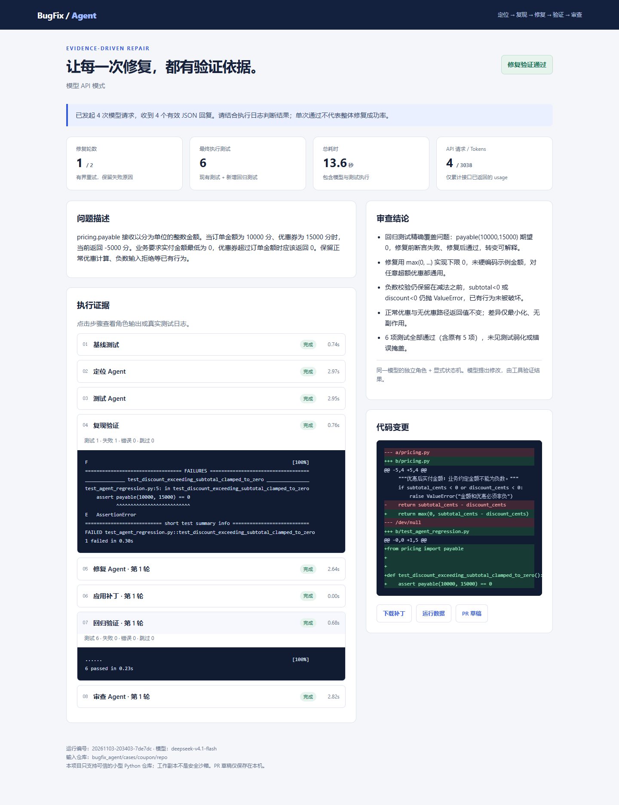

# 两分钟演示指南

这份指南展示已经存在的运行证据。视频尚未录制；历史 live 报告不是现场调用，replay 不计入模型修复成绩。

## 录制前准备

在克隆后的项目根目录打开 CMD，先运行一次不需要密钥的演示，确认本机环境可用：

```cmd
python -m pip install -e .
python -m bugfix_agent demo --case coupon --open
```

这次运行使用预设角色回复，最终应有 7 项测试通过。历史 coupon live 只生成了 1 项新测试，最终是 6 项通过；两者不能混用统计。

再准备两个浏览器标签页与一份源码。在项目根目录的 CMD 执行：

```cmd
start "" "docs\evidence\coupon-live\report.html"
start "" "docs\evidence\pagination-live\report.html"
notepad "bugfix_agent\cases\coupon\repo\pricing.py"
```

报告须在克隆后本地打开；GitHub 文件页不执行 HTML。真实调用来源和模型身份限制见[运行记录](真实模型运行记录.md)。

## 画面与口播

| 时间 | 画面 / 操作 | 口播要点 |
|---|---|---|
| 0:00–0:15 | `pricing.py` 中原始减法 | “订单 10000 分、优惠 15000 分时，这段代码返回负数。原有五个测试通过，但漏掉了这个边界。” |
| 0:15–0:35 | coupon 历史 live 报告顶部 | “这是已经保存的真实 API 运行记录，编号以 7de7dc 结尾。四个角色使用同一模型，工具负责执行和验收。它在第一轮完成修复。” |
| 0:35–1:00 | 展开「复现验证」，再展开「回归验证 · 第 1 轮」 | “新测试先在原代码上断言失败，修复后原有五项加新增一项全部通过。导入错误、跳过或本来就通过，都不能算复现。” |
| 1:00–1:20 | 右侧代码变更与审查结论 | “补丁增加零下界，保留负数输入校验。Fixer 只能修改授权源码，不能改测试；最后再审查需求、diff 和测试证据。” |
| 1:20–1:40 | pagination 历史 live 报告 | “另一个分页案例新增五项测试，原代码上两项失败，修复后八项通过。两个简单案例只证明流程联调，不能推导泛化成功率。” |
| 1:40–2:00 | 返回 coupon，展示运行数据和 PR 草稿入口 | “证据包含日志、补丁、用量和本地 PR 草稿。最多修复两轮，失败会保留原因。这是可信小仓库的原型，工作副本不是安全沙箱。” |

如果改为现场 live，请先在交互终端完成密钥输入，再开始录制；等待过长可以剪辑，但字幕须注明加速或省略等待，不改动报告数字。完整命令见 [README](../README.md#接入-deepseek-官方-api)。不要把终端里显示的第三方平台运行称为官方接口实测。

## 核对数字

| 证据 | coupon live | pagination live |
|---|---:|---:|
| 原有测试 | 5 | 3 |
| 新增测试 | 1 | 5 |
| 原代码断言失败 | 1 | 2 |
| 修复后通过 | 6 | 8 |
| 请求 / 有效回复 | 4 / 4 | 4 / 4 |
| 总耗时 | 13.57 秒 | 39.818 秒 |
| 输入 / 输出 Tokens | 2677 / 361 | 2907 / 560 |

数据来自同目录证据中的 [coupon JSON](evidence/coupon-live/report.json) 和 [pagination JSON](evidence/pagination-live/report.json)。average 尚无 live 记录。Reviewer 的批准是流程条件，不是独立正确性证明。

### 截图素材

下面是 2026-11-04 从已脱敏的 coupon 历史 live 报告截取的画面，展开了复现与回归日志。它对应 2026-11-03 的调用，没有重新调用模型；报告顶部耗时四舍五入显示为 13.6 秒，JSON 保留 13.57 秒。



## 失败分支备选画面

本机若保留 `runs/showcase-failed-coupon/report.html`，可用它替换第二案例画面，并标注“构造的 replay 失败样例，无 API 调用”。它向 Fixer 注入无法匹配的补丁，两轮均因 `search` 未精确匹配而停止，最终需要人工检查。该目录不随仓库发布，不作为克隆后必备步骤。

也可展示[运行记录中的接口排障](真实模型运行记录.md#失败与排障)：历史 403 / 401 都发生在定位请求阶段，不能作为模型修复失败率。不要把构造失败、接口失败与模型修复失败混为一类。

## 相对成熟 Agent 的价值与边界

项目的展示重点是可检查的验收流程：新测试先红后绿、源码编辑范围校验、测试保护、有限重试和证据输出。角色数量本身不是优势，也没有证据证明本项目优于成熟 harness。实现只支持可信、依赖标准库与 pytest 的小型平铺 Python 仓库；Docker 沙箱、远端修复 PR、MCP 与通用开源仓库评测均未实现。
